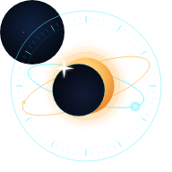

<p align="center"></p>

<h1 align="center">ASTERID</h1>

<p align="center"><b>Sun · Earth · Moon</b> — ephemeris, eclipse prediction, dan lunar observation dalam satu berkas HTML</p>

<p align="center"><a href="https://rakawi182.github.io/ASTERID-OBSV/"><b>▶ Buka aplikasi</b></a></p>

> _A single-file astronomy web app: Sun–Moon ephemeris, eclipse prediction and lunar observation tools, with an in-page audit against published test vectors._

## Ringkasan

ASTERID adalah aplikasi web satu berkas (`ASTERID.html`) untuk perhitungan astronomi posisi dan eclipse. Seluruh series dan data tertanam di dalam berkas, sehingga aplikasi berjalan offline, dan setiap hasil dapat diuji langsung di halaman lewat **Ephemeris Audit** terhadap test vectors dari publikasi.

## Fitur

Aplikasi memiliki sembilan halaman:

| Halaman | Isi |
|---|---|
| **SKY VIEW** | Peta langit dalam horizon frame (stereographic projection) yang mengikuti sensor gerak perangkat (gyroscope) atau geseran jari. Menampilkan bintang Hipparcos berwarna dari B−V, constellation lines, celestial equator dan ecliptic, Matahari, planet Merkurius–Neptunus (dengan magnitude), serta Bulan dengan phase dan topocentric parallax. Pada gerhana bulan, umbra dan penumbra ikut digambar. Mode kamera (AR) bersifat opsional, dan waktu mengikuti jam global. Sensor dan kamera hanya aktif lewat HTTPS |
| **PLANETS** | Merkurius sampai Neptunus: geocentric apparent place (true equator and equinox of date) untuk ketujuh planet dari series VSOP2013 penuh bila `vsop2013_mercury.bin`, `vsop2013_venus.bin`, `vsop2013_mars.bin`, `vsop2013_jupiter.bin`, `vsop2013_saturn.bin`, `vsop2013_uranus.bin`, dan `vsop2013_neptune.bin` termuat, jika tidak (hanya di dalam 500–2498 CE) dari series IPS2000 penuh, dengan light-time delay dan aberration. Rentang −4000…+8000 (rentang VSOP2013 dan model Bumi). Setiap planet menampilkan RA/Dec, ecliptic λ/β, jarak ke Bumi dan Matahari, altitude/azimuth (di stasiun TOPOCENTRIC memakai rantai koreksi penuh tab TOPOCENTRIC; di lokasi HUD lain memakai rantai yang sama tanpa data khusus stasiun (deflection of the vertical dihitung per lokasi di dalam area DEM dan XGM), dengan refraction dari grid GPT3 global atau standard atmosphere, dan kartu diberi label), elongation, phase angle dan illuminated fraction, angular diameter, magnitude (Mallama & Hilton 2018), arah gerak (prograde/retrograde), serta next rise, transit, dan set. Ketuk planet untuk membukanya di SKY VIEW |
| **HUD** | Celestial sphere dengan layer dan kontrol pandangan; observer (horizon, PZX), spherical trigonometry lab, astronomical triangle PZX 3D; posisi Matahari dan Bulan; syzygy dan eclipse; jalur gerhana matahari (peta dan lokal); **Ephemeris Audit** |
| **ORBIT · ANGLES** | Segitiga Sun–Earth–Moon: elongation, phase angle, jarak, dan tampilan 3D ecliptic plane |
| **MOON FACE** | Efemeris fisik Bulan (phase, libration, sub-solar point, position angle sumbu) dengan cakram dari mosaik LROC-WAC dan relief GLD100; gerhana bulan; appulse Bulan dengan bintang katalog |
| **TIME SCALES** | Konverter time scales (UTC, UT1, TT, TCG, ERA, GMST/GST, dan lainnya) |
| **TOPOCENTRIC** | Posisi topocentric untuk **stasiun tetap** Jolotundo (Mt. Pawitra; −7,609444°, 112,595556°, 583,355 m), bukan lokasi HUD: refraction, atmospheric gradients (APG), tropospheric delay VMF3, RTM reference surface, real-time meteorology (ECMWF), dan non-tidal loading |
| **ECLIPSE CATALOG** | Katalog gerhana NASA −1999…+3000 (11.898 gerhana matahari dan 12.064 gerhana bulan) dengan Saros series |
| **STAR CATALOG** | Katalog Hipparcos: 8.870 bintang V ≤ 6,5 (new reduction 2007; proper motion dan parallax dari HGCA/Gaia EDR3 untuk 8.429 bintang). Tersedia apparent place, altitude dan azimuth pada lokasi dan waktu HUD, B−V (cross-checked dengan GCPD, BSC, Ducati), spectral type (BSC, Hipparcos), bintang ganda/majemuk, dan data bintang variabel (Vol. 11 dan GCVS 5.1). Fitur lain: atlas rasi (peta stereografik, overlay Almagest), kalkulator heliacal rising/setting (model Schaefer 1993), pencarian nomor HIP, nama, atau rasi (misalnya "orion" atau "cma"), badge rasi IAU di tiap baris, pengurutan MAG/HIP/ALT/RA, serta filter HUD stars, above horizon, dan multiple |

Kontrol waktu simulasi (maju/mundur, kecepatan, lunar phase, eclipse, perigee/apogee) tersedia di bagian atas halaman.

**Ephemeris Audit** menjalankan pengujian langsung di halaman terhadap test vectors dari publikasi: VSOP2013, IPS2000, JANUS, SOFA, IERS, LLIB, Meeus, dan NASA/Espenak, termasuk transit Mercury 2019 dan Venus 2012.

## Inti perhitungan

| Komponen | Model dan sumber |
|---|---|
| **Sun dan Earth** | VSOP2013 |
| **Merkurius** | VSOP2013 (Simon dkk. 2013): series Poisson penuh tanpa truncation (272.360 suku di `VSOP2013p1.dat`), dimuat dari `vsop2013_mercury.bin` (3,3 MiB); tanpa berkas itu Merkurius memakai IPS2000. Posisi heliosentris dalam ICRS, kerangka yang sama dengan model Bumi |
| **Venus** | VSOP2013 (Simon dkk. 2013): series Poisson penuh tanpa truncation (289.647 suku di `VSOP2013p2.dat`), dimuat dari `vsop2013_venus.bin` (3,5 MiB); tanpa berkas itu Venus memakai IPS2000. Posisi heliosentris dalam ICRS, kerangka yang sama dengan model Bumi |
| **Mars** | VSOP2013 (Simon dkk. 2013): series Poisson penuh tanpa truncation (309.140 suku di `VSOP2013p4.dat`), dimuat dari `vsop2013_mars.bin` (4,3 MiB); tanpa berkas itu Mars memakai IPS2000. Posisi heliosentris dalam ICRS, kerangka yang sama dengan model Bumi |
| **Jupiter** | VSOP2013 (Simon dkk. 2013): series Poisson penuh tanpa truncation (324.608 suku di `VSOP2013p5.dat`), dimuat dari `vsop2013_jupiter.bin` (3,7 MiB); tanpa berkas itu Jupiter memakai IPS2000. Posisi heliosentris dalam ICRS, kerangka yang sama dengan model Bumi |
| **Saturn** | VSOP2013 (Simon dkk. 2013): series Poisson penuh tanpa truncation (350.525 suku di `VSOP2013p6.dat`), dimuat dari `vsop2013_saturn.bin` (4,0 MiB); tanpa berkas itu Saturn memakai IPS2000. Posisi heliosentris dalam ICRS, kerangka yang sama dengan model Bumi |
| **Uranus** | VSOP2013 (Simon dkk. 2013): series Poisson penuh tanpa truncation (330.581 suku di `VSOP2013p7.dat`), dimuat dari `vsop2013_uranus.bin` (3,8 MiB); tanpa berkas itu Uranus memakai IPS2000. Posisi heliosentris dalam ICRS, kerangka yang sama dengan model Bumi |
| **Neptune** | VSOP2013 (Simon dkk. 2013): series Poisson penuh tanpa truncation (322.572 suku di `VSOP2013p8.dat`), dimuat dari `vsop2013_neptune.bin` (3,8 MiB); tanpa berkas itu Neptune memakai IPS2000. Posisi heliosentris dalam ICRS, kerangka yang sama dengan model Bumi |
| **Cadangan dan pembanding planet** | IPS2000 (Chapront & Francou 2002): full Poisson series tanpa truncation untuk 500–2498 CE (35.432 terms, disimpan lossless), dipakai bila berkas `.bin` VSOP2013 sebuah planet belum termuat (hanya di dalam 500–2498 CE; di luarnya tidak ada cadangan) dan sebagai pembanding independen di audit. Apparent place dihitung dengan light-time delay, aberration, dan precession–nutation frame yang sama dengan Matahari dan Bulan |
| **Moon** | ELP/MPP02 (LLR fit); JANUS dipakai di luar \|t\| = 30 century |
| **Stars** | Katalog Hipparcos (new reduction, van Leeuwen 2007), posisi epoch J1991.25 dipropagasi linear ke J2000. Untuk 8.429 bintang dipakai long-term proper motion Hipparcos–Gaia dan parallax Gaia EDR3 (HGCA, Brandt 2021). Magnitude V dan color dari ESA SP-1200 (1997). Apparent place memakai jalur yang sama dengan HUD (parallax, light deflection, aberration, precession–nutation) |
| **Constellations** | Batas rasi IAU (Delporte 1930, tabel Roman 1987) pada posisi yang diprecess ke B1875.0 |
| **Precession–nutation** | IAU 2006/2000A (setara `iauNut06a` SOFA) |
| **ΔT** | Spline Morrison dkk. (2021) untuk −720…+2019, lalu parabola jangka panjang di luar tabel |
| **EOP** | Series IERS 20 C04 dan Bulletin A, tertanam di dalam berkas |
| **Non-tidal loading** | ESMGFZ (NTAL, NTOL, HYDL, SLEL) |

## Cara memakai

1. Buka <https://rakawi182.github.io/ASTERID-OBSV/> di browser, **atau** unduh `ASTERID.html` dan buka langsung di browser (Chrome, Firefox, Edge, dan sebagainya).
2. Aplikasi hampir seluruhnya berjalan **offline** karena semua data dan series sudah tertanam. Pengecualiannya adalah **real-time meteorology** (ECMWF IFS HRES melalui [Open-Meteo](https://open-meteo.com)) yang membutuhkan internet. Hasilnya disimpan di `localStorage` hingga 6 jam. Lokasi HUD lain di dalam area DEM dan XGM mengambil permintaannya sendiri (empat lokasi terakhir disimpan). Tanpa data itu, aplikasi memakai model GPT3.

Ukuran berkas sekitar 25 MB (24,7 MiB) karena seluruh series ephemeris dan data tertanam; sebagian disimpan dengan lossless compression. Pemuatan pertama lewat data seluler cukup berat.

Satu data tidak tertanam: **`gpt3_1.bin`** (1,8 MiB), grid GPT3 global (1° × 1°) untuk refraction di lokasi HUD di luar stasiun. Berkas ini diletakkan di folder yang sama dengan `ASTERID.html` dan dimuat saat dibutuhkan, sehingga `ASTERID.html` tetap di bawah batas unggah browser GitHub (25 MiB). Dibuka lewat `file://`, browser memblokir pemuatan otomatis; pilih `gpt3_1.bin` dengan tombol **LOAD gpt3_1.bin** di tab PLANETS, atau pakai **`ASTERID_full.html`** dari halaman Releases (±33 MiB, satu berkas yang sudah memuat grid itu). Tanpa grid, aplikasi memakai standard refraction dan banner menyebutkannya. Dengan cara yang sama, **`opole_0p5.bin`** (2,0 MiB) membawa koefisien ocean pole tide loading global (Desai 2002, 0,5° × 0,5°) untuk lokasi HUD di luar stasiun (tombol **LOAD opole_0p5.bin**), dan **`otl_fes2014b_1.bin`** (1,5 MiB) membawa grid ocean tide loading global dari FES2014b (harmonik bola derajat 100, 11 gelombang utama, 1° × 1°; tombol **LOAD otl_fes2014b_1.bin**); **`apl_rp_1.bin`** (0,8 MiB) membawa grid atmospheric pressure loading global gelombang S1/S2 dan turunannya (Ray & Ponte 2003, load Love number Gegout, 1° × 1°; tombol **LOAD apl_rp_1.bin**); **`vsop2013_mercury.bin`** (3,3 MiB), **`vsop2013_venus.bin`** (3,5 MiB), **`vsop2013_mars.bin`** (4,3 MiB), **`vsop2013_jupiter.bin`** (3,7 MiB), **`vsop2013_saturn.bin`** (4,0 MiB), **`vsop2013_uranus.bin`** (3,8 MiB), dan **`vsop2013_neptune.bin`** (3,8 MiB) membawa deret VSOP2013 penuh untuk ketujuh planet (Merkurius sampai Neptunus) (Simon dkk. 2013; tombol **LOAD vsop2013_mercury.bin**, **LOAD vsop2013_venus.bin**, **LOAD vsop2013_mars.bin**, **LOAD vsop2013_jupiter.bin**, **LOAD vsop2013_saturn.bin**, **LOAD vsop2013_uranus.bin**, dan **LOAD vsop2013_neptune.bin**; tanpa berkas itu planet bersangkutan memakai IPS2000 dan baris LED **VSOP MER**, **VSOP VEN**, **VSOP MAR**, **VSOP JUP**, **VSOP SAT**, **VSOP URA**, dan **VSOP NEP** menunjukkan statusnya). `ASTERID_full.html` memuat keempat grid itu. Pembaca VSOP2013 juga menerima salinan tertanam lewat `window.__VSOP_B64 = {mercury: '…', venus: '…', mars: '…', jupiter: '…', saturn: '…', uranus: '…', neptune: '…'}`, tetapi `build_full.py` belum menanamnya.

## Pasang sebagai aplikasi (PWA)

1. Buka <https://rakawi182.github.io/ASTERID-OBSV/> di Chrome (Android) atau Safari (iPhone), lalu tunggu hingga halaman terbuka penuh.
2. Chrome: menu ⋮ → **Pasang aplikasi** / **Tambahkan ke layar utama**. Safari: **Bagikan** → **Tambah ke Layar Utama**.
3. Setelah dibuka sekali, aplikasi berjalan offline. Setiap kali dibuka, versi terbaru diperiksa di background dan dipakai pada pembukaan berikutnya.

Untuk mengaktifkan GitHub Pages: **Settings → Pages → Deploy from a branch → main / (root)**. Jika berkas HTML diganti namanya, ubah `APP_FILE` di `sw.js` dan `index.html`.

## Memperbarui data tertanam

Skrip `update_asterid_data.py` (Python 3 dan NumPy) memperbarui series **EOP IERS** dan grid **ESMGFZ** loading di dalam `ASTERID.html` tanpa membangun ulang aplikasi. Contoh:

```bash
# C04 dan Bulletin A baru
python3 update_asterid_data.py ASTERID.html --c04 EOP_20u24_C04_one_file_1962-now.txt --bulletin bulletina-xxxix-043.txt

# hanya Bulletin A mingguan
python3 update_asterid_data.py ASTERID.html --bulletin bulletina-xxxix-044.txt

# hanya C04
python3 update_asterid_data.py ASTERID.html --c04 EOP_20u24_C04_one_file_1962-now.txt
```

Opsi yang berguna: `--out BERKAS` (menulis ke berkas lain, disarankan agar berkas lama menjadi backup), `--dry-run` (hanya melaporkan), `--force`, dan `--ntal/--ntol/--hydl/--slel` untuk berkas CSV ESMGFZ. Rincian lengkap ada di docstring pada bagian atas skrip.

Sumber berkas IERS: <https://hpiers.obspm.fr/eoppc/eop/eopc04/> dan <https://datacenter.iers.org/eop.php> (C04), serta <https://datacenter.iers.org/eop.php> dan <https://maia.usno.navy.mil> (Bulletin A). Setelah pembaruan, unggah ulang `ASTERID.html` ke repositori agar versi online ikut berubah.

## Akurasi dan keterbatasan

Angka berikut adalah ketidakpastian yang dinyatakan di dalam aplikasi (halaman **ACCURACY · MODELS · REFERENCES** dan **Ephemeris Audit**), bukan klaim baru.

**Sun, Moon, dan model dasar**
- JANUS: 0,5″ + 0,75″·|t| (longitude). VSOP2013 EMB: 0,02 mas (1890–2000) hingga 0,03″ (900–3100) terhadap INPOP10a. Truncation series nutation R06: 0,1 µas.
- Di luar |t| = 30 century, Bulan JANUS diselaraskan ke ELP/MPP02 melalui fitted longitude correction. Hasil sebelum −1000 **tidak diverifikasi secara independen**.
- Tabel lunar features dimasukkan manual dan baik hingga sekitar ±1° (±30 km) pada posisi selenographic.
- Batas gerhana matahari historis cocok dengan ephemeris dan ΔT dalam ±20 detik untuk −708…1567.

**Stars**
- Katalog memakai new reduction Hipparcos (2007). Untuk 8.429 bintang, proper motion dan parallax berasal dari HGCA (Hipparcos–Gaia, Gaia EDR3), dipropagasi linear dari J1991.25.
- Radial velocity: Hipparcos Vol. 1 Tabel 1.2.3 (21 bintang), lalu Gaia DR2 melalui HGCA (σ ≤ 5 km/s), selebihnya 0.
- B−V berasal dari Hipparcos (dengan source code H39 pada label) dan dikoreksi untuk 218 bintang yang menyimpang lebih dari 0,05 mag dari konsensus minimal dua kompilasi (GCPD, BSC, Ducati). V (source code H7) dikoreksi dengan aturan yang sama untuk 87 bintang non-variabel. Kompilasi tersebut tidak sepenuhnya independen satu sama lain.
- Alt/Az bersifat geometric (tanpa refraction).

**Planets**
- Rentang tab PLANETS dan SKY VIEW adalah −4000…+8000 (rentang deret VSOP2013 dan model Bumi; batas yang sama dengan modul Matahari). Di dalam 500–2498 CE perilaku lama tetap: VSOP2013 bila `.bin` termuat, jika tidak IPS2000. Di luar 500–2498 CE tidak ada cadangan IPS2000: ketujuh berkas `.bin` harus termuat; sampai saat itu tab PLANETS menampilkan status muat (dengan tombol LOAD bila berkas gagal diambil, mis. dari `file://`) dan SKY VIEW tidak menggambar planet. Di luar −4000…+8000 tab PLANETS kosong. Di luar 500–2498 CE tidak ada deret independen sebagai pembanding; yang ada hanya galat yang dinyatakan penyusun VSOP2013 (README IMCCE, longitude heliosentris, −4000…+8000): Merkurius 0,20″, Venus 0,15″, Mars 1,74″, Jupiter 4,47″, Saturnus 11,73″, Uranus 2,45″, Neptunus 1,27″, terbesar jauh dari jendela pencocokan 1890–2000 (tab PLANETS menampilkan keterangan ini di luar 500–2498 CE). Pada 15 epoch −3990…+7990 arah tampak dari jalur cepat (blok Chebyshev) berbeda dari deret eksak paling besar 1,8 µas. Elemen deret eksak (double) dibandingkan dengan evaluasi presisi diperluas (longdouble, pembaca Python terpisah) di tujuh epoch −4000…+8000: selisih terbesar 7×10⁻¹² rad pada longitude rata-rata Merkurius (≈ 3×10⁻¹² au) dan 2×10⁻¹³ au pada sumbu panjang Neptunus, jauh di bawah galat teori. Angka-angka ini tidak mencakup ketidakpastian ΔT dan rotasi Bumi pada epoch jauh (berpengaruh pada altitude/azimuth serta rise, transit, set).
- Venus dari VSOP2013 (bila `vsop2013_venus.bin` termuat): selisih yang dinyatakan penyusunnya terhadap INPOP10a adalah 0,02 mas pada longitude heliosentris dan 0,002 km pada jarak (1890–2000), serta 0,15″ dan 4 km (−4000…+8000). Pada 11 epoch `VSOP2013.ctl` hasilnya cocok hingga 4,9×10⁻¹¹ au (batas pembulatan acuan 10 desimal); terhadap IPS2000 pada 11 epoch 500–2498 selisih 3-D maksimum 7,4×10⁻⁸ au (sekitar 0,02″ pada longitude heliosentris). Tampak Venus dari kedua deret berbeda 7,5 mas pada 2026-11-15 12:00 UTC.
- Merkurius dari VSOP2013 (bila `vsop2013_mercury.bin` termuat): selisih yang dinyatakan penyusunnya terhadap INPOP10a adalah 0,06 mas pada longitude heliosentris dan 0,008 km pada jarak (1890–2000), serta 0,20″ dan 9 km (−4000…+8000). Pada 11 epoch `VSOP2013.ctl` hasilnya cocok hingga 5,0×10⁻¹¹ au (batas pembulatan acuan 10 desimal); terhadap IPS2000 pada 11 epoch 500–2498 selisih 3-D maksimum 9,0×10⁻⁸ au (sekitar 0,05″ pada longitude heliosentris). Toleransi audit untuk pembanding ini, 1,5×10⁻⁷ au, berasal dari selisih terbesar IPS2000 terhadap DE406 yang tercatat di atas (0,064″, planet mana pun) pada jarak aphelion Merkurius; nilai khusus Merkurius tidak tercantum di dokumentasi yang kami pegang. Tampak Merkurius dari kedua deret berbeda 3,1 mas pada 2026-11-15 12:00 UTC.
- Mars dari VSOP2013 (bila `vsop2013_mars.bin` termuat): selisih yang dinyatakan penyusunnya terhadap INPOP10a adalah 0,93 mas pada longitude heliosentris dan 0,162 km pada jarak (1890–2000), serta 1,74″ dan 153 km (−4000…+8000). Pada 11 epoch `VSOP2013.ctl` hasilnya cocok hingga 5,0×10⁻¹¹ au (batas pembulatan acuan 10 desimal). Terhadap IPS2000 pada 11 epoch 500–2498 selisih 3-D maksimum 4,0×10⁻⁶ au (600 km; 0,50″ pada longitude heliosentris), dan selisih itu hampir seluruhnya berasal dari masa lalu jauh: 0,50″ pada 500 CE, 0,09″ pada 1100 CE, dan paling besar 0,02″ dari 1499 CE ke atas. Pola ini sesuai dengan sifat VSOP2013 (dicocokkan ke INPOP10a pada 1890–2000 lalu diekstrapolasi) dibanding IPS2000 (dicocokkan ke DE406); toleransi audit 1,2×10⁻⁵ au berasal dari galat longitude 1,74″ yang dinyatakan penyusun VSOP2013 untuk −4000…+8000, pada jarak perihelion Mars 1,381 au. Tampak Mars dari kedua deret berbeda 6,1 mas pada 2026-11-15 12:00 UTC.
- Jupiter dari VSOP2013 (bila `vsop2013_jupiter.bin` termuat): selisih yang dinyatakan penyusunnya terhadap INPOP10a adalah 0,20 mas pada longitude heliosentris dan 0,277 km pada jarak (1890–2000), serta 4,47″ dan 3393 km (−4000…+8000). Pada 11 epoch `VSOP2013.ctl` hasilnya cocok hingga 5,4×10⁻¹¹ au (batas pembulatan acuan 10 desimal). Terhadap IPS2000 pada 11 epoch 500–2498 selisih 3-D maksimum 4,9×10⁻⁵ au (7350 km; 1,9″ pada longitude heliosentris), dan selisih itu menurun mulus dari masa lalu: 1,9″ pada 500 CE, 1,3″ pada 1100 CE, 0,41″ pada 1700 CE, dan hanya 0,12″ pada 1900 CE (3,2×10⁻⁶ au); lalu naik lagi ke 0,74″ pada 2498 CE. Pola ini sesuai dengan sifat VSOP2013 (dicocokkan ke INPOP10a pada 1890–2000 lalu diekstrapolasi) dibanding IPS2000 (dicocokkan ke DE406). Toleransi audit 1,1×10⁻⁴ au berasal dari galat longitude 4,47″ yang dinyatakan penyusun VSOP2013 untuk −4000…+8000, pada jarak perihelion Jupiter 4,95 au; selisih teramati memakai 45 % toleransi itu. Tampak Jupiter dari kedua deret berbeda 49 mas pada 2026-11-15 12:00 UTC.
- Saturn dari VSOP2013 (bila `vsop2013_saturn.bin` termuat): selisih yang dinyatakan penyusunnya terhadap INPOP10a adalah 0,24 mas pada longitude heliosentris dan 0,592 km pada jarak (1890–2000), serta 11,73″ dan 21.911 km (−4000…+8000). Pada 11 epoch `VSOP2013.ctl` hasilnya cocok hingga 6,5×10⁻¹¹ au (batas pembulatan acuan 10 desimal). Terhadap IPS2000 pada 11 epoch 500–2498 selisih 3-D maksimum 2,1×10⁻⁵ au (3170 km; 0,49″ pada longitude heliosentris), hampir seluruhnya di masa lalu jauh: 0,49″ pada 500 CE, 0,24″ pada 700 CE, dan 0,06–0,14″ (3–6×10⁻⁶ au) dari 900 CE ke atas, sejalan dengan selisih IPS2000 terhadap DE406 yang dinyatakan penyusunnya (hingga 0,064″ untuk Saturn). Toleransi audit 5,1×10⁻⁴ au berasal dari galat longitude 11,73″ yang dinyatakan penyusun VSOP2013 untuk −4000…+8000, pada jarak perihelion Saturn 9,0 au; selisih teramati hanya 4 % dari toleransi itu, sehingga toleransi ini longgar untuk rentang 500–2498. Tampak Saturn dari kedua deret berbeda 36 mas pada 2026-11-15 12:00 UTC.
- Uranus dari VSOP2013 (bila `vsop2013_uranus.bin` termuat): selisih yang dinyatakan penyusunnya terhadap INPOP10a adalah 2,19 mas pada longitude heliosentris dan 5,962 km pada jarak (1890–2000), serta 2,45″ dan 13.007 km (−4000…+8000). Pada 11 epoch `VSOP2013.ctl` hasilnya cocok hingga 6,0×10⁻¹¹ au (batas pembulatan acuan 10 desimal). Terhadap IPS2000 pada 11 epoch 500–2498 selisih 3-D maksimum 7,8×10⁻⁵ au (11.700 km; 0,81″ pada longitude heliosentris di 500 CE): 0,66″ pada 700 CE, 0,42″ pada 1100 CE, 0,04–0,09″ pada 1700–2100 CE, lalu naik lagi ke 0,44″ pada 2298 CE. Pola ini sesuai dengan sifat VSOP2013 (dicocokkan ke INPOP10a pada 1890–2000 lalu diekstrapolasi) dibanding IPS2000 (dicocokkan ke DE406). Toleransi audit 2,2×10⁻⁴ au berasal dari galat longitude 2,45″ yang dinyatakan penyusun VSOP2013 untuk −4000…+8000, pada jarak perihelion Uranus 18,29 au; selisih teramati memakai 35 % toleransi itu. Tampak Uranus dari kedua deret berbeda 146 mas pada 2026-11-15 12:00 UTC.
- Neptune dari VSOP2013 (bila `vsop2013_neptune.bin` termuat): selisih yang dinyatakan penyusunnya terhadap INPOP10a adalah 0,38 mas pada longitude heliosentris dan 2,764 km pada jarak (1890–2000), serta 1,27″ dan 7761 km (−4000…+8000). Pada 11 epoch `VSOP2013.ctl` hasilnya cocok hingga 8,0×10⁻¹¹ au (batas pembulatan acuan 10 desimal; pada jarak 30 au pembulatan acuan XYZ dominan). **Selisih terhadap IPS2000 jauh lebih besar daripada planet lain**: pada 11 epoch 500–2498 maksimum 3-D 2,0×10⁻³ au (299.000 km; 13,6″ pada longitude heliosentris di 500 CE), yaitu 12,3″ pada 700 CE, 4,6″ pada 1500 CE, 0,6″ pada 1900 CE (di dalam jendela pencocokan VSOP2013), 1,6″ pada 2100 CE, dan 4,6″ pada 2498 CE. Selisih ini jauh melampaui galat yang dinyatakan penyusun VSOP2013 (1,27″ untuk −4000…+8000) maupun selisih IPS2000 terhadap DE406 (0,006″ untuk Neptune). Karena pembaca VSOP2013 cocok dengan `VSOP2013.ctl` dan pembaca IPS2000 cocok dengan `notice.txt` (masing-masing hingga 10⁻¹⁰ au), ini bukan galat pembacaan: selisih terjadi antara dua teori acuan (VSOP2013 dicocokkan ke INPOP10a pada 1890–2000, IPS2000 ke DE406); penyebab pastinya belum diteliti, dan tidak ada dasar di dokumentasi yang dipegang untuk menyatakan teori mana yang lebih dekat ke posisi sebenarnya pada 500 CE. Toleransi audit 2,5×10⁻³ au adalah selisih teramati ditambah 25 % (pagar regresi, bukan validasi); toleransi dari galat yang dinyatakan penyusun (1,8×10⁻⁴ au pada jarak perihelion 29,73 au) terlampaui 11 kali. Tampak Neptune dari kedua deret berbeda 240 mas pada 2026-11-15 12:00 UTC.
- Selisih IPS2000 terhadap DE406 yang dinyatakan penyusunnya pada heliocentric longitude maksimum 0,006″ (Neptune) hingga 0,064″ (Saturn).
- Series disimpan lossless sebagai float64 persis seperti berkas `ips2000.*`. Pada 11 epoch uji `notice.txt`, hasilnya cocok hingga 7×10⁻¹¹ au, yaitu batas pembulatan nilai acuan 10 desimal.
- Transit Mercury 11 November 2019 dan Venus 6 Juni 2012 cocok dengan Espenak dalam 0,04″ dan 0,4″ (acuan Venus dicetak dalam arcsecond bulat), dan dalam 0,3 s untuk waktu minimum separation.
- Alt/azimuth planet memakai rantai TOPOCENTRIC penuh di stasiun tetap (dalam 1 km dari lokasi HUD). Di lokasi lain rantai yang sama berjalan lewat `compute(R,E,{lat,lon,h})` tanpa data yang hanya ada di stasiun: solid Earth tide, pole tide, polar motion, s′, diurnal aberration, dan VMF3 diterapkan; refraction dari grid GPT3 global (`gpt3_1.bin`; tekanan, suhu, dan uap air pada tinggi orografi model sel 1°, plus gradien APG di bawah 15°) atau, bila berkas itu belum termuat, standard atmosphere (1010 hPa, 10 °C, kering). Di dalam area DEM dan XGM di sekitar stasiun (jarak ke tepi DEM ≥ 6 km dan di selatan 7,5° LS: sekitar 12 km ke utara, 7 km ke timur dan barat, 4,7 km ke selatan dari stasiun), deflection of the vertical dihitung di lokasi HUD itu sendiri (XGM2019e di lokasi tersebut ditambah RTM dari DEM dengan lokasi sebagai pengamat; ±2 detik setelah lokasi berubah, hasilnya di-cache), tinggi dari tinggi stasiun ditambah selisih DEM, dan meteorology dari ECMWF live yang diambil di lokasi itu sendiri (satu permintaan per lokasi, koordinat dibulatkan ke 0,01°, sel IFS 0,1°; p, T, e direduksi dari elevasi titik pada respons ke tinggi lokasi; aktif bila saklar ECMWF ON dan waktu dalam ±1 jam dari jam perangkat) atau, bila tidak tersedia, dari empat sel GPT3 tertanam di sekitar stasiun dengan bobot bilinear lokasi itu. Gerbangnya berupa kotak, bukan lingkaran: DEM (±30 × 26 km, tidak berpusat di stasiun) dan grid XGM hanya mencakup sekitar stasiun, sehingga lokasi harus berjarak ≥ 6 km dari setiap tepi DEM (RTM hanya kehilangan massa di luar jarak itu) dan berada di dalam empat sel GPT3 tertanam (lintang ≤ −7,5°); di luar area itu deflection tidak diterapkan (dapat mencapai detik busur). Tidak diterapkan di luar stasiun: ESMGFZ; atmospheric pressure loading S1/S2 (`apl_rp_1.bin`, radial; grid dibatasi derajat 10 (S1: 20), sehingga di stasiun menyimpang hingga sekitar 0,1 mm dari konstanta stasiun), ocean pole tide (`opole_0p5.bin`) dan ocean tide loading (`otl_fes2014b_1.bin`, dekat pantai dapat menyimpang beberapa persen amplitudo karena derajat 100) diterapkan dari grid global bila berkasnya termuat; di luar area DEM dan XGM juga ECMWF live. Konsistensi diaudit terhadap rantai TOPOCENTRIC di stasiun (selisih tidak boleh melebihi sudut yang dibentuk perpindahan khusus stasiun). Tinggi orografi model dapat berbeda dari tinggi sebenarnya; selisih 100 m mengubah tekanan sekitar 12 hPa.
- Magnitude planet (Mallama & Hilton 2018), angular diameter, serta rise, transit, dan set planet belum memiliki test vectors di audit.

Aplikasi ini adalah alat bantu penelitian. Untuk publikasi, verifikasi hasil kunci dengan sumber independen.

## Struktur repositori

```
.
├── ASTERID.html              # aplikasi (satu berkas)
├── gpt3_1.bin                # grid GPT3 global untuk refraction di luar stasiun (dimuat sesuai kebutuhan)
├── opole_0p5.bin             # koefisien ocean pole tide loading global (Desai 2002, 0,5°) untuk lokasi di luar stasiun (dimuat sesuai kebutuhan)
├── otl_fes2014b_1.bin        # grid ocean tide loading global (FES2014b, derajat 100, 1°) untuk lokasi di luar stasiun (dimuat sesuai kebutuhan)
├── apl_rp_1.bin              # grid atmospheric pressure loading global S1/S2 (Ray & Ponte 2003, 1°) untuk lokasi di luar stasiun (dimuat sesuai kebutuhan)
├── vsop2013_jupiter.bin      # deret VSOP2013 penuh untuk Jupiter (Simon dkk. 2013) untuk tab PLANETS dan SKY VIEW (dimuat sesuai kebutuhan)
├── vsop2013_saturn.bin       # deret VSOP2013 penuh untuk Saturn (Simon dkk. 2013) untuk tab PLANETS dan SKY VIEW (dimuat sesuai kebutuhan)
├── vsop2013_uranus.bin       # deret VSOP2013 penuh untuk Uranus (Simon dkk. 2013) untuk tab PLANETS dan SKY VIEW (dimuat sesuai kebutuhan)
├── vsop2013_neptune.bin      # deret VSOP2013 penuh untuk Neptune (Simon dkk. 2013) untuk tab PLANETS dan SKY VIEW (dimuat sesuai kebutuhan)
├── vsop2013_mercury.bin      # deret VSOP2013 penuh untuk Merkurius (Simon dkk. 2013) untuk tab PLANETS dan SKY VIEW (dimuat sesuai kebutuhan)
├── vsop2013_mars.bin         # deret VSOP2013 penuh untuk Mars (Simon dkk. 2013) untuk tab PLANETS dan SKY VIEW (dimuat sesuai kebutuhan)
├── vsop2013_venus.bin        # deret VSOP2013 penuh untuk Venus (Simon dkk. 2013) untuk tab PLANETS dan SKY VIEW (dimuat sesuai kebutuhan)
├── update_asterid_data.py    # pembaru data EOP IERS dan ESMGFZ loading
├── index.html                # entry point GitHub Pages
├── manifest.webmanifest      # metadata PWA
├── sw.js                     # service worker (offline)
├── icon-192.png  icon-512.png  maskable-512.png
├── apple-touch-icon.png  favicon.svg   # logo dan ikon
├── tools/                    # build_gpt3_bin.py, build_opole_bin.py, build_otl_bin.py, build_apl_bin.py, build_vsop2013_bin.py, build_full.py, test_*_bin.py, patch_asterid_vsop_venus.py, patch_asterid_vsop_mercury.py, patch_asterid_vsop_mars.py, patch_asterid_vsop_jupiter.py, patch_asterid_vsop_saturn.py, patch_asterid_vsop_uranus.py, patch_asterid_vsop_neptune.py, patch_asterid_range.py, otl_decoder.js (opsional)
├── README.md
├── CHANGELOG.md
├── CITATION.cff              # metadata sitasi (tombol "Cite this repository")
├── CITATIONS.md              # daftar pustaka dan sumber data
├── LICENSE                   # MIT
└── .gitignore
```

## Proyek terkait

[OSS ΩLDJAVA](https://github.com/rakawi182/OSS_OLDJAVA): aplikasi archaeoastronomy dan kalender Jawa Kuno dalam satu berkas HTML.

## Sitasi

Jika Anda memakai ASTERID dalam penelitian, kutip repositori ini (lihat `CITATION.cff` atau tombol **Cite this repository** di GitHub) beserta pustaka ilmiah yang mendasarinya di [`CITATIONS.md`](CITATIONS.md).

## Lisensi

Kode di repositori ini dilisensikan di bawah [MIT License](LICENSE). Data dan model pihak ketiga (VSOP2013, IPS2000, ELP/MPP02, data IERS, katalog gerhana NASA, katalog Hipparcos (ESA), HGCA, GCVS, BSC, GCPD, Ducati, ESMGFZ, mosaik LROC-WAC dan GLD100, Open-Meteo, dan lainnya) tetap tunduk pada ketentuan masing-masing penyedia; lihat [`CITATIONS.md`](CITATIONS.md).

## Kontribusi

Laporan bug dan saran sangat disambut lewat [Issues](../../issues). Mohon sertakan tanggal dan jam input, lokasi observer, hasil yang diharapkan, dan sumber pembandingnya.
